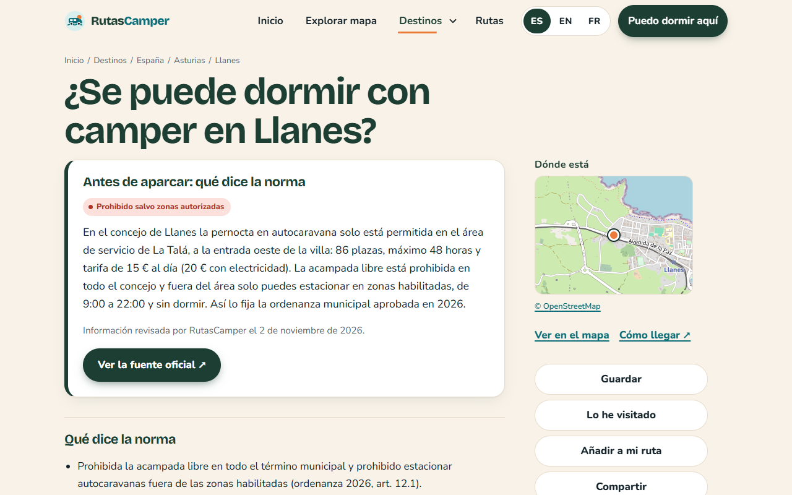
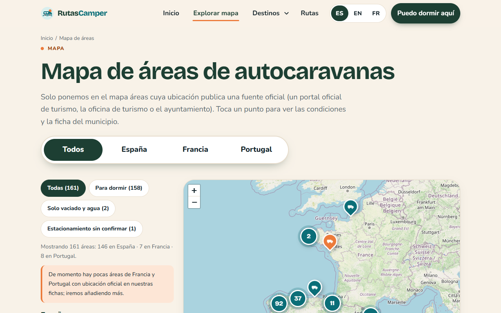
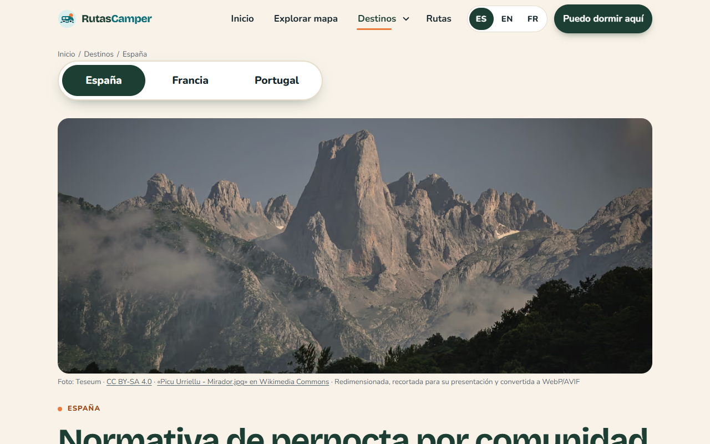
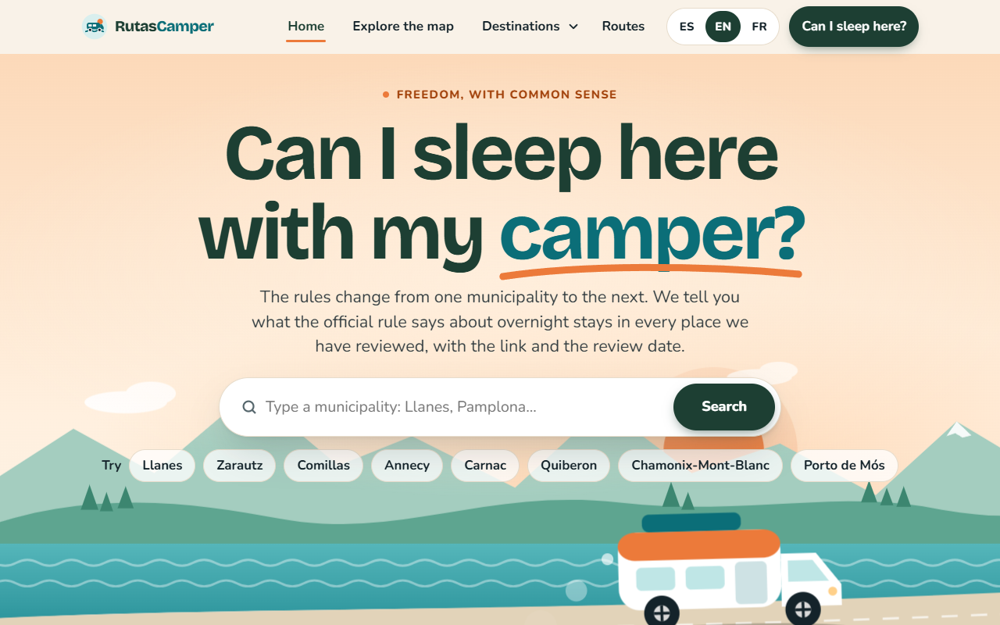
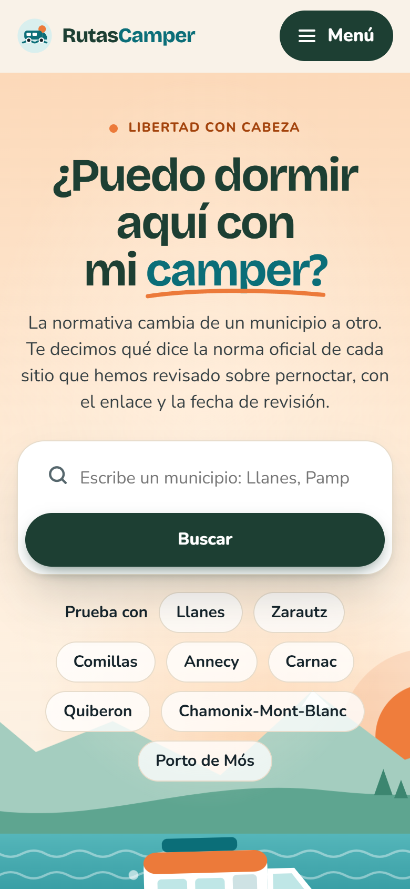

# RutasCamper

**¿Puedo dormir aquí con mi camper?** Web estática y multilingüe que explica, municipio a municipio, qué dice la norma oficial sobre pernoctar con camper o autocaravana en España, Francia y Portugal, siempre con el enlace a la fuente y la fecha de revisión.

🌐 **En producción:** [rutascamper.com](https://rutascamper.com)


## Qué hace

- **Buscador con sugerencias** que muestra el estado de cada municipio (se puede pernoctar, con restricciones, prohibido salvo zonas autorizadas, sin ordenanza localizada) y la fecha de la última revisión.
- **Fichas por municipio** con resumen, artículos aplicables, áreas de autocaravanas y la fuente oficial (BOE, boletines autonómicos, ordenanzas municipales, portales oficiales de turismo).
- **Mapa de áreas** con Leaflet y OpenStreetMap, agrupación de marcadores y filtro por país. Solo se dibujan áreas cuya ubicación publica una fuente oficial.
- **«Mi ruta» y «Mis guardados»**: planificador de paradas en el navegador (localStorage), con distancias en línea recta y enlace compartible, sin cuentas ni servidor.
- **Tres países y tres idiomas** (español, inglés y francés) con `hreflang`, sitemap por idioma y textos de interfaz centralizados.
- **Pantalla por país** con cifras calculadas automáticamente a partir de los datos publicados.

| Portada | Ficha de municipio | Mapa |
|---|---|---|
|  |  |  |

| España | Versión en inglés | Móvil |
|---|---|---|
|  |  |  |

## Tecnología

| Área | Elección |
|---|---|
| Framework | [Astro](https://astro.build) 7, generación estática (≈300 páginas) |
| Lenguaje | TypeScript |
| Contenido | ~270 archivos JSON validados con esquemas de *content collections* (Zod) |
| Mapa | Leaflet + Leaflet.markercluster + teselas de OpenStreetMap |
| Estilos | CSS propio con variables, sin framework; fuentes autoalojadas (Fontsource) |
| Despliegue | Cloudflare Workers (*static assets*) con Wrangler |
| CI | GitHub Actions: build y pruebas en cada *push* y cada lunes |

## Decisiones técnicas destacables

- **El contenido es la fuente de verdad.** Cada ficha es un JSON con esquema estricto (`src/content.config.ts`). Una ficha solo se genera en producción si está marcada como verificada y tiene una fuente oficial; los borradores se ven únicamente en desarrollo.
- **Pruebas sobre el resultado generado** (`scripts/check.mjs`), que hacen fallar el despliegue si:
  - una ficha verificada no tiene fuente oficial o fecha de revisión;
  - hay enlaces internos rotos, páginas sin título o sin `h1`;
  - una traducción cambia una cifra respecto al original o falta el `hreflang` recíproco;
  - una coordenada cae fuera del país o no indica de dónde sale;
  - una foto no tiene autor y licencia en el manifiesto;
  - alguna página lleva scripts en línea (la CSP los prohíbe).
- **Seguridad por defecto:** CSP sin `'unsafe-inline'` en scripts (Astro está configurado para no incrustar JavaScript en el HTML), HSTS y demás cabeceras en `public/_headers`.
- **Privacidad:** sin formularios, sin cookies propias y sin registro. Lo que guarda el visitante (ruta, favoritos) se queda en su navegador y solo se escribe cuando lo pide.
- **Accesibilidad:** las animaciones respetan `prefers-reduced-motion`; el buscador usa el patrón *combobox* de ARIA.
- **Internacionalización preparada para crecer:** registro único de países (`src/lib/paises.ts`), textos en `src/i18n/` y vistas compartidas en `src/views/`. Añadir un país o un idioma no obliga a duplicar páginas.

## Estructura

```
src/
├── content.config.ts   # esquemas de los datos
├── data/               # fichas: comunidades, municipios, Francia, Portugal, rutas, fotos
├── i18n/               # textos de interfaz (es, en, fr)
├── lib/                # lógica: buscador, áreas del mapa, países, fotos
├── components/         # componentes Astro
├── layouts/ views/     # plantilla base y vistas compartidas entre idiomas
├── pages/              # rutas (incluye [lang]/ para /en/ y /fr/)
├── scripts/            # JavaScript del cliente
└── styles/
scripts/check.mjs       # pruebas sobre dist/
public/_headers         # cabeceras de seguridad
```

## Ejecutarlo en local

Requisitos: Node.js 22 o superior.

```bash
npm ci
npm run dev        # servidor de desarrollo en http://localhost:4321
npm run build      # genera dist/
npm run check      # pruebas sobre dist/ (debe dar 0 errores)
```

La analítica es opcional: copia `.env.example` a `.env` y rellena `PUBLIC_CF_BEACON` si quieres el contador de Cloudflare Web Analytics. Sin ese valor la web se genera sin contador.

## Flujo de ramas

`main` recibe solo lo que ha pasado por `develop`. Cada bloque de trabajo vive en su propia rama (`chore/…`, `feat/…`, `test/…`, `docs/…`) y se integra en `develop` con un *merge* explícito; `develop` se integra en `main` al publicar una versión.

## Contenido y fuentes

Los textos normativos resumen fuentes oficiales citadas en cada ficha. Algunas fuentes se reutilizan con condiciones (por ejemplo, la Agencia de Turismo de Galicia o DATAtourisme): la atribución va en la propia ficha. Las fotos proceden de Wikimedia Commons con licencias libres; autor, licencia y cambios están en `src/data/fotos.json` y en la página `/creditos-fotos/`. La información es orientativa y no sustituye el asesoramiento jurídico.

## Autor

**Freddy Materano** · proyecto personal · [rutascamper.com/quienes-somos](https://rutascamper.com/quienes-somos/)
